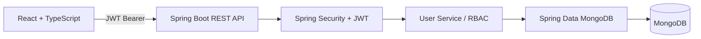

# User Management System

**Spring Boot · Spring Security · MongoDB · React · TypeScript**

A full-stack engineering demonstration of JWT authentication, permission-aware user management, searchable records and a responsive administrator dashboard. This is a **portfolio project**, not a production identity provider.


## What you can do

- Register a standard user with validated details and a BCrypt-hashed password.
- Sign in using a username/email/phone identifier and receive a signed, expiring JWT.
- View your own profile through `GET /users/me`.
- Sign in as an administrator to search, filter, page, create, edit, activate, deactivate and soft-delete user accounts.
- Explore the documented REST API using Swagger UI and run the stack with Docker Compose.
- Run backend integration tests against MongoDB and build-check the frontend in GitHub Actions.

## Preview of the architecture



## Stack

| Layer | Technologies |
|---|---|
| Backend | Java 17, Spring Boot 3.4.8, Spring MVC |
| Security | Spring Security, JWT (JJWT), BCrypt, method-level permissions |
| Database | MongoDB, Spring Data MongoDB, MongoTemplate |
| Frontend | React 19, TypeScript, Vite 7 |
| API | REST, DTO validation, consistent responses, OpenAPI / Swagger |
| Delivery | Docker Compose, Nginx, GitHub Actions |
| Tests | JUnit 5, Mockito, Spring MockMvc, MongoDB integration testing |

## Quick start: Docker Compose

You need Docker with Compose support.

```bash
git clone https://github.com/5hu13ham/user-management.git
cd user-management
cp .env.example .env
```

Before continuing, edit `.env` and set a **strong unique** `JWT_SECRET` (32+ bytes) and unique `BOOTSTRAP_ADMIN_PASSWORD` (12+ characters). Do not commit `.env`.

```bash
docker compose up --build -d
```

| Service | URL |
|---|---|
| React dashboard | http://localhost:5173 |
| Spring Boot API | http://localhost:8080 |
| Swagger UI | http://localhost:8080/swagger-ui.html |
| API spec (JSON) | http://localhost:8080/v3/api-docs |
| Health ping | http://localhost:8080/api/ping |

The Compose stack starts MongoDB internally and persists data in a named Docker volume. It does not publish the database port to your machine.

**Demo administrator:** With `BOOTSTRAP_ADMIN_ENABLED=true`, a first administrator is created from the username/email/password set in `.env`. This initializer is idempotent and does not overwrite an existing account. Disable the flag after initial provisioning. Normal registration always creates a standard USER account.

## Local development without Docker Compose

- Install Java 17, Node.js 22 and MongoDB 7.
- Set `MONGODB_URI` to a reachable Mongo instance and `JWT_SECRET` to a strong random signing secret.
- Optionally set `BOOTSTRAP_ADMIN_ENABLED=true` and the three bootstrap credentials in your environment.
- Start the backend with `./mvnw spring-boot:run`.
- In `user-management-frontend/`, run `npm ci` then `npm run dev`.

The API allows `http://localhost:5173` as its CORS origin by default. Override `CORS_ALLOWED_ORIGIN` for other local frontend addresses.

## API reference

### Public endpoints

| Method | Path | Purpose |
|---|---|---|
| POST | `/auth/register` | Register with the USER role |
| POST | `/auth/login` | Obtain JWT and role |
| GET | `/api/ping` | Test backend connectivity |

Example registration:

```bash
curl -X POST http://localhost:8080/auth/register \
  -H 'Content-Type: application/json' \
  -d '{"username":"sampleuser","email":"sample@example.com","firstName":"Sample","password":"choose-a-unique-password"}'
```

### Protected endpoints

| Method | Path | Required access |
|---|---|---|
| GET | `/users/me` | Authenticated user |
| GET | `/users` | `ADMIN_READ` |
| GET | `/users/filter-search` | `ADMIN_READ` |
| GET | `/users/{id}` | `ADMIN_READ` |
| POST | `/users` | `ADMIN_WRITE` |
| PUT | `/users/{id}` | `ADMIN_WRITE` |
| PATCH | `/users/{id}/active` | `ADMIN_WRITE` |
| DELETE | `/users/{id}` | `ADMIN_WRITE` |

Pass `Authorization: Bearer <JWT_TOKEN>` for protected requests. Example search: `/users/filter-search?keyword=alex&role=USER&active=true&page=0&size=10&sortBy=username&sortDir=asc`.

The response includes user records and pagination metadata. Search text is escaped, supported sort fields are allowlisted, and page size is bounded to 100.

## Testing

```bash
# With a local MongoDB server running on port 27017
./mvnw verify

cd user-management-frontend
npm ci
npm run lint
npm run build
```

CI provisions MongoDB and executes the backend tests plus frontend checks on every relevant push or PR.

## Engineering trade-offs

- User documents **embed a role and its permissions**. This is simple for demonstration, but changes to role templates will not retroactively update existing users.
- Standard users can view their own profile; directory operations require administrator permissions.
- A token is valid for one hour. Deleted and disabled accounts are rejected when reloaded.
- The frontend stores its short-lived demo session in `sessionStorage`; a production application needs a more carefully designed session model, stronger XSS/CSRF protection, auditing, rate limiting and account recovery.
- The project doesn't claim live deployment, production-grade hardening, complex multi-tenant policy management or user adoption.

## Further reading

- [Architecture and design choices](docs/ARCHITECTURE.md)
- [Phase 1 interview notes](docs/PHASE1_INTERVIEW_NOTES.md)
- [Phase 2–4 interview notes](docs/PHASE2_TO_4_INTERVIEW_NOTES.md)

---

**Built by Shubham Kumar** — Java Backend Engineer
